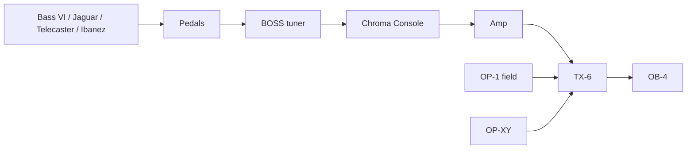

# music

Sam's music setup, tracked as code — plus a Copilot skill that knows it.

## What's here

| Path | Purpose |
|------|---------|
| `gear/inventory.yaml` | Source of truth: every piece of gear, docs + firmware links |
| `gear/<id>.md` | Per-device reference: firmware updates, I/O, features, built-in sounds |
| `setup/signal-chain.md` | How everything is cabled today (diagram + table) |
| `setup/recording.md` | Plan for recording the whole rig onto the OP-1 field |
| `creative/ideas-log.md` | Log of creative suggestions and how they landed |
| `.github/skills/music-setup/SKILL.md` | The Copilot skill |

## Using the skill

Open Copilot in this repo and just ask. Examples:

- *"How do I update my OP-1 field?"*
- *"How do I set a scale on the OP-XY?"*
- *"I'm adding a looper pedal — where should it go?"*
- *"How do I record my Jaguar and the OP-XY together on the OP-1 field?"*
- *"I'm stuck — give me 10 things to try."*

The skill answers from this repo and the official docs, and updates these
files as the setup changes.

## Current setup

## Open questions (fill these in to make the skill smarter)

- Amp model, and which amp output goes to the TX-6
- Pedals before the tuner (models, order)
- BOSS tuner model (TU-3 / TU-3W / TU-3S?)
- Bass VI, Jaguar, Telecaster variants; Ibanez model and whether it has a pickup
- TX-6 channel assignments
- Confirm the kalimba is the Lottie Canto "Colour Palette"
