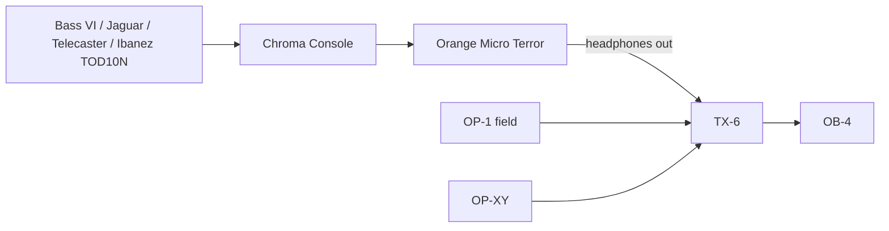

# music

Sam's music setup, tracked as code — plus a Copilot skill that knows it.

## What's here

| Path | Purpose |
|------|---------|
| `gear/inventory.yaml` | Source of truth: every piece of gear, docs + firmware links |
| `gear/manuals.yaml` | Official manuals, by URL (never the files themselves) |
| `gear/<id>.md` | Per-device reference: firmware updates, I/O, features, built-in sounds |
| `setup/signal-chain.md` | How everything is cabled today (diagram + table) |
| `setup/recording.md` | Plan for recording the whole rig onto the OP-1 field |
| `creative/ideas-log.md` | Log of creative suggestions and how they landed |
| `.github/skills/music-setup/SKILL.md` | The Copilot skill |
| `.github/skills/music-setup/scripts/` | The skill's tools (manuals, diagrams) |
| `setup/diagrams/` | Diagram recipes (YAML) the skill renders to pictures |

## Using the skill

Open Copilot in this repo and just ask. Examples:

- *"How do I update my OP-1 field?"*
- *"How do I set a scale on the OP-XY?"*
- *"I'm adding a looper pedal — where should it go?"*
- *"How do I record my Jaguar and the OP-XY together on the OP-1 field?"*
- *"I'm stuck — give me 10 things to try."*

The skill answers from this repo and the official docs, and updates these
files as the setup changes.

## Manuals

Official manuals are **linked, not stored**: `gear/manuals.yaml` records each
one's official URL, version and checksum. The skill downloads them on demand
into a cache outside the repo (`~/.cache/music-manuals`) and cites exact
pages. Why links instead of committed PDFs: this repo is public and the
manuals are the vendors' copyrighted material; some are big (the OP-XY guide
is ~30 MB, and every revision would stay in git history); and a stored copy
silently drifts from the official one after firmware updates. Each manual
downloads in about a second, and `check` notices when a link breaks or a
newer version is published, so the skill can tell you and fix the registry.

Needs [uv](https://docs.astral.sh/uv/), which provisions Python and the
dependencies automatically:

```powershell
uv run .github/skills/music-setup/scripts/manuals.py list
uv run .github/skills/music-setup/scripts/manuals.py search op-1-field "input"
uv run .github/skills/music-setup/scripts/manuals.py text op-1-field-guide 12
uv run .github/skills/music-setup/scripts/manuals.py check   # links alive? anything newer?
uv run .github/skills/music-setup/scripts/tests/test_offline.py   # offline smoke tests
```

## Visual answers

When it helps, the skill shows you the official page, crops just the figure
that matters, or composes a picture: official drawings and boxes joined by
arrows labelled with the cable and the jack names, with the right jack
highlighted. Images are written to `out/` (gitignored, never committed: they
contain the vendors' drawings); diagrams worth keeping are committed as small
YAML recipes in `setup/diagrams/`, e.g. the current rig and recording mode.

```powershell
uv run .github/skills/music-setup/scripts/manuals.py page op-1-field-guide 4 --grid     # plan a crop
uv run .github/skills/music-setup/scripts/manuals.py page op-1-field-guide 4 --box 0.556,0.585,0.765,0.945
uv run .github/skills/music-setup/scripts/manuals.py sheet tx-6-guide                    # page thumbnails
uv run .github/skills/music-setup/scripts/diagram.py setup/diagrams/recording-mode.yaml
```

## Current setup



## Open questions (fill these in to make the skill smarter)

- BOSS tuner model (TU-3 / TU-3W / TU-3S?), and is it still on the pedalboard?
- Is there a speaker cabinet for the Micro Terror? It needs one connected
  whenever nothing is plugged into its headphones jack.
- Bass VI, Jaguar, Telecaster variants
- TX-6 channel assignments
- Confirm the kalimba is the Lottie Canto "Colour Palette"
