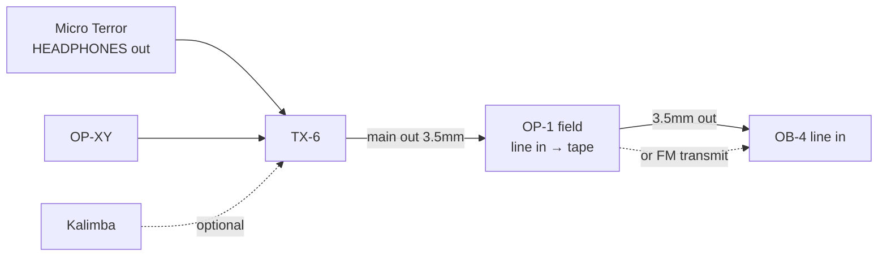

# Recording the whole rig on the OP-1 field

**Goal:** capture everything that goes into the TX-6 (guitars/bass via the
Chroma Console and the Orange Micro Terror, OP-XY, kalimba, etc.) onto the
OP-1 field's 4-track tape.

## The catch: feedback loop

In the everyday setup the OP-1 field's output feeds a TX-6 channel. If you
also send the TX-6 mix *into* the OP-1 field, the OP-1 passes its input back
out → TX-6 → OP-1 → … = feedback howl. So recording needs a slightly different
"recording mode" cabling.

## Recommended "recording mode" (no loop, simple)

Make the OP-1 field the **last** stop in the chain instead of a TX-6 source.

The same routing drawn with the official drawings (which jack, which screen):
render `setup/diagrams/recording-mode.yaml` with the skill's `diagram.py`.

1. Unplug the OP-1 field's output from its TX-6 channel.
2. Cable **TX-6 main out → OP-1 field input jack** (3.5mm TRS stereo; the
   OP-1 field's input is a stereo line-in, 13 kΩ, 0–31 dB gain).
3. Monitor through the OP-1 field: move the OB-4 cable so it's
   **OP-1 field out → OB-4 line in**. Cable-free alternative: use the OP-1
   field's FM **transmitter** and set the OB-4 to FM radio — OP-1 field can sync
   its transmit frequency with an OB-4 (firmware 1.2.9+).
4. On the OP-1 field, press **shift + input** to open the input screen: the
   **blue** encoder picks the source (*built-in microphone / line in*),
   **ochre** sets stereo/mono, **orange** the input gain (set it so the
   loudest parts don't clip) and **gray** the recording threshold; the
   **input** key toggles the selected input on/off
   ([OP-1 field guide p54](https://assets.teenage.engineering/_img/69f248938d433104c4dd1846_original.pdf#page=54)).
   Then press **tape**, pick a track with **T1–T4**, hold **record** while the
   rig plays and press **stop** when done
   ([p39](https://assets.teenage.engineering/_img/69f248938d433104c4dd1846_original.pdf#page=39)).
5. Overdub on the other tape tracks. Record OP-1 field synth parts directly
   (no cables needed — internal), and live TX-6 parts via the input.
6. Mix down / export: 4 tracks → stereo mixdown on the OP-1; transfer files
   over USB-C (MTP disk mode).

Tips:
- TX-6 has its own per-channel EQ + compressor and send FX (reverb, chorus,
  delay) — get the mix sounding right on the TX-6 before recording, since
  it's printed as one stereo track.
- To record parts on separate tape tracks, record one source at a time (mute
  the others on the TX-6).
- The OP-1 field has an **"input signal safety"** system setting (fw 1.5.7) —
  look it up in the guide before relying on it.

## Alternative: USB audio (digital, no analog noise)

The OP-1 field advertises direct USB audio/MIDI connectivity with the TX-6.
Connect TX-6 ↔ OP-1 field with USB-C, set the OP-1 field as USB audio host and
the TX-6 as device. Recent OP-1 field firmware supports multi-channel USB
input with input-channel selection, which may allow recording individual TX-6
channels. **Unverified in practice — try it and document the steps here.**

## Alternative: TX-6 as its own recorder

The TX-6 can record a 24-bit/48 kHz stereo WAV of its mix to a USB drive
("disk recorder", with auto-start on signal). Useful as a quick safety
recording, but no multitrack/tape tricks like the OP-1 field.

## Status

- [ ] Try recording mode (the OP-1 field steps above are from the guide; note
      what works in practice)
- [ ] Try USB audio TX-6 → OP-1 field
- [ ] Note the input gain setting that works for the amp + OP-XY mix
