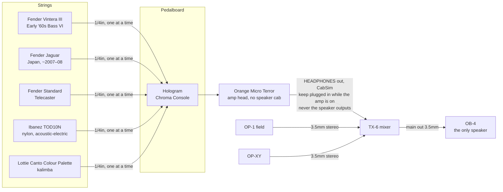

# Current signal chain

Last updated: 2026-10-11

A picture of the same chain built from the official drawings:
`setup/diagrams/current-rig.yaml` (render it with the skill's `diagram.py`;
keep it in sync with this file).

## Connections

| From | Out jack | To | In jack | Cable | Notes |
|------|----------|----|---------|-------|-------|
| Bass VI / Jaguar / Telecaster / Ibanez TOD10N / Colour Palette kalimba | 1/4in | Chroma Console | INPUT L | instrument cable | one instrument at a time |
| Chroma Console | OUTPUT L | Orange Micro Terror | INPUT | instrument cable | |
| Orange Micro Terror | HEADPHONES (1/4in, CabSim) | TX-6 | channel TODO, mono mode | 1/4in → 3.5mm | **never** the speaker outputs |
| OP-1 field | 3.5mm out | TX-6 | channel TODO | 3.5mm stereo | |
| OP-XY | 3.5mm out | TX-6 | channel TODO | 3.5mm stereo | |
| TX-6 | main out | OB-4 | line in (top panel) | 3.5mm stereo, 3-pole | the only speaker |

## TX-6 channel map

| Ch | Source |
|----|--------|
| 1 | TODO |
| 2 | TODO |
| 3 | TODO |
| 4 | TODO |
| 5 | TODO |
| 6 | TODO |

## Shaping the tone

Where the tone controls are along the chain, in signal order. For "too bassy /
thin / harsh / muddy" or "make it sound like…" questions, work through them
left to right and change one stage at a time. A worked example: getting a
guitar-like tone from the Bass VI (`gear/bass-vi.md`).

| Stage | Tone controls | Source |
|-------|---------------|--------|
| Instrument | Bass VI: 3 pickup on/off switches, low cut ("strangle") switch, tone knob, mute (`gear/bass-vi.md`). Jaguar: lead / rhythm circuits, pickup switches, strangle switch (`gear/jaguar.md`). Telecaster: 3-way pickup selector, tone knob (`gear/telecaster.md`). Ibanez TOD10N: AEQ210TF preamp TREBLE / BASS (`gear/ibanez-acoustic.md`) | the device files |
| Chroma Console | Character TILT (dark ↔ bright) with Drive or Sweeten; Texture **Filter** (TILT, low-pass or high-pass); MIX at 100% effected, so no dry signal gets around the filter | [manual p6](https://cdn.shopify.com/s/files/1/0920/2928/8752/files/CC_manual_WEB.pdf?v=1758823440#page=6), [p11–12](https://cdn.shopify.com/s/files/1/0920/2928/8752/files/CC_manual_WEB.pdf?v=1758823440#page=11), [p17](https://cdn.shopify.com/s/files/1/0920/2928/8752/files/CC_manual_WEB.pdf?v=1758823440#page=17), [p29](https://cdn.shopify.com/s/files/1/0920/2928/8752/files/CC_manual_WEB.pdf?v=1758823440#page=29) |
| Orange Micro Terror | TONE (clockwise = brighter); GAIN (clean → heavy distortion) | [manual p3](https://cdn.shopify.com/s/files/1/0943/5250/7206/files/Micro_Terror_-_Word_Manual_2025_V1.0_EN.pdf?v=1758622989#page=3) |
| TX-6, the amp's channel | 3-band EQ on the channel's parameter knobs (blue = high, orange = mid, white = low, ±18 dB per band); low-pass / high-pass filter in the track menu | [guide p29](https://assets.teenage.engineering/_img/66152ced1cfae6ae3cfe32a7_original.png), [p30](https://assets.teenage.engineering/_img/66152ced1cfae6ae3cfe329a_original.png), [p25](https://assets.teenage.engineering/_img/66152cee1cfae6ae3cfe32c2_original.png) |

## Known issues / notes

- **BOSS TU-3S tuner:** not drawn. Whether it's still on the board is TODO.
  If it is, it goes first, before the Chroma Console: its manual says other
  effects must come after it (see `gear/boss-tuner.md`).
- **Chroma Console jacks:** they're printed INPUT L / R and OUTPUT L / R; with
  a mono guitar, either input and either output works
  ([Chroma Console manual p43](https://cdn.shopify.com/s/files/1/0920/2928/8752/files/CC_manual_WEB.pdf?v=1758823440#page=43)).
- **Amp → TX-6:** the Micro Terror's HEADPHONES jack (1/4in, with CabSim) is
  also meant for connecting to a mixer
  ([Micro Terror manual p3](https://cdn.shopify.com/s/files/1/0943/5250/7206/files/Micro_Terror_-_Word_Manual_2025_V1.0_EN.pdf?v=1758622989#page=3)).
  Use a 1/4in → 3.5mm cable, pick **mono** when the TX-6 asks for the input
  mode, and start with the amp volume and channel gain low.
- **No speaker cabinet:** the OB-4 is the only speaker. The manual requires a
  speaker cabinet whenever nothing is plugged into HEADPHONES
  ([Micro Terror manual p3](https://cdn.shopify.com/s/files/1/0943/5250/7206/files/Micro_Terror_-_Word_Manual_2025_V1.0_EN.pdf?v=1758622989#page=3)),
  so **keep the HEADPHONES → TX-6 cable plugged in whenever the amp is on**.
  Details: `gear/orange-micro-terror.md`.
- **One amp for every instrument:** the Micro Terror is a guitar amp, and its
  HEADPHONES out always has the CabSim (an Orange 4×12 guitar cabinet sound),
  with no switch for it in the manual. GAIN can't go to zero either ("no sound
  will be heard"), so the valve preamp is always in the path
  ([Micro Terror manual p3](https://cdn.shopify.com/s/files/1/0943/5250/7206/files/Micro_Terror_-_Word_Manual_2025_V1.0_EN.pdf?v=1758622989#page=3)).
  The amp has one input, so the Chroma Console's stereo effects end up mono.
  For the kalimba and the nylon acoustic, an option to try is skipping the
  amp: Chroma Console OUTPUT L + R (or the instrument straight) into a TX-6
  channel (see `gear/orange-micro-terror.md`, "Using it for non-guitar
  instruments").
- **Recording goal:** see `setup/recording.md`.
