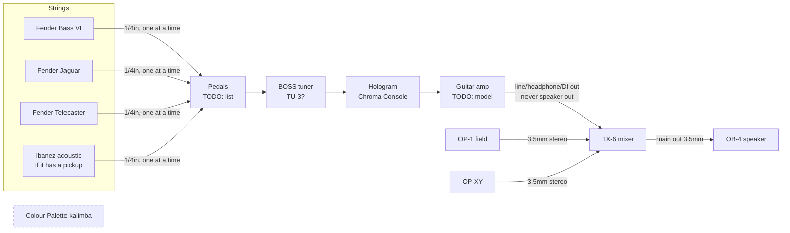

# Current signal chain

Last updated: 2026-10-09

## Connections

| From | Out jack | To | In jack | Cable | Notes |
|------|----------|----|---------|-------|-------|
| Bass VI / Jaguar / Telecaster | 1/4in | first pedal | 1/4in | instrument cable | one instrument at a time |
| pedals | 1/4in | BOSS tuner | INPUT | patch cable | pedal list TODO |
| BOSS tuner | OUTPUT | Chroma Console | IN (L/mono) | patch cable | OUTPUT mutes while tuning |
| Chroma Console | OUT (L/mono) | amp | input | instrument cable | |
| amp | TODO (line/headphone/DI) | TX-6 | channel TODO | 1/4in → 3.5mm | **never** the speaker out |
| OP-1 field | 3.5mm out | TX-6 | channel TODO | 3.5mm stereo | |
| OP-XY | 3.5mm out | TX-6 | channel TODO | 3.5mm stereo | |
| TX-6 | main out | OB-4 | line in (back) | 3.5mm stereo, 3-pole | |
| Colour Palette kalimba | 1/4in mono | — | — | — | not in the chain yet |

## TX-6 channel map

| Ch | Source |
|----|--------|
| 1 | TODO |
| 2 | TODO |
| 3 | TODO |
| 4 | TODO |
| 5 | TODO |
| 6 | TODO |

## Known issues / notes

- **Tuner placement:** the tuner sits after the other pedals. Tuning is most
  accurate from a clean signal — bypass drive/fuzz/modulation before tuning, or
  move the tuner to the front of the board. See `gear/boss-tuner.md`.
- **Amp → TX-6:** TX-6 inputs are 3.5mm stereo line-level. Use the amp's line,
  headphone, or DI output with a 1/4in → 3.5mm cable and keep the TX-6 channel
  gain low at first. Confirm which output once the amp model is known.
- **Kalimba options:** its 1/4in out can go into the front of the pedalboard
  (to use the Chroma Console on it) or straight into a free TX-6 channel via a
  1/4in → 3.5mm cable.
- **Recording goal:** see `setup/recording.md`.
