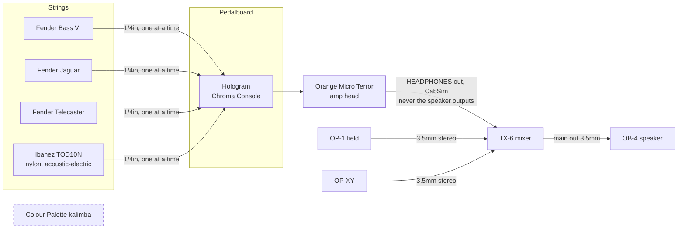

# Current signal chain

Last updated: 2026-10-10

A picture of the same chain built from the official drawings:
`setup/diagrams/current-rig.yaml` (render it with the skill's `diagram.py`;
keep it in sync with this file).

## Connections

| From | Out jack | To | In jack | Cable | Notes |
|------|----------|----|---------|-------|-------|
| Bass VI / Jaguar / Telecaster / Ibanez TOD10N | 1/4in | Chroma Console | INPUT L | instrument cable | one instrument at a time |
| Chroma Console | OUTPUT L | Orange Micro Terror | INPUT | instrument cable | |
| Orange Micro Terror | HEADPHONES (1/4in, CabSim) | TX-6 | channel TODO, mono mode | 1/4in → 3.5mm | **never** the speaker outputs |
| OP-1 field | 3.5mm out | TX-6 | channel TODO | 3.5mm stereo | |
| OP-XY | 3.5mm out | TX-6 | channel TODO | 3.5mm stereo | |
| TX-6 | main out | OB-4 | line in (back) | 3.5mm stereo, 3-pole | |
| Colour Palette kalimba | 1/4in mono | — | — | — | not in the chain yet |

## TX-6 channel map

| Ch | Source |
|----|--------|
| 1 | TODO |
| 2 | TODO |
| 3 | TODO |
| 4 | TODO |
| 5 | TODO |
| 6 | TODO |

## Known issues / notes

- **BOSS tuner:** not drawn. Whether it's still on the board is TODO (see
  `gear/boss-tuner.md`).
- **Chroma Console jacks:** they're printed INPUT L / R and OUTPUT L / R; with
  a mono guitar, either input and either output works
  ([Chroma Console manual p43](https://cdn.shopify.com/s/files/1/0920/2928/8752/files/CC_manual_WEB.pdf?v=1758823440#page=43)).
- **Amp → TX-6:** the Micro Terror's HEADPHONES jack (1/4in, with CabSim) is
  also meant for connecting to a mixer
  ([Micro Terror manual p3](https://cdn.shopify.com/s/files/1/0943/5250/7206/files/Micro_Terror_-_Word_Manual_2025_V1.0_EN.pdf?v=1758622989#page=3)).
  Use a 1/4in → 3.5mm cable, pick **mono** when the TX-6 asks for the input
  mode, and start with the amp volume and channel gain low. With nothing in
  HEADPHONES, the amp needs a speaker cabinet connected (same page). Details:
  `gear/orange-micro-terror.md`.
- **Kalimba options:** its 1/4in out can go into the front of the pedalboard
  (to use the Chroma Console on it) or straight into a free TX-6 channel via a
  1/4in → 3.5mm cable.
- **Recording goal:** see `setup/recording.md`.
